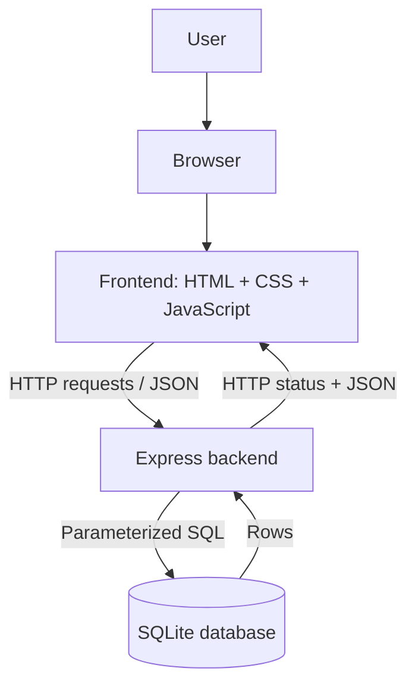
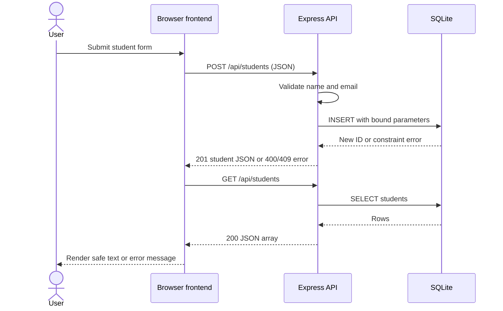
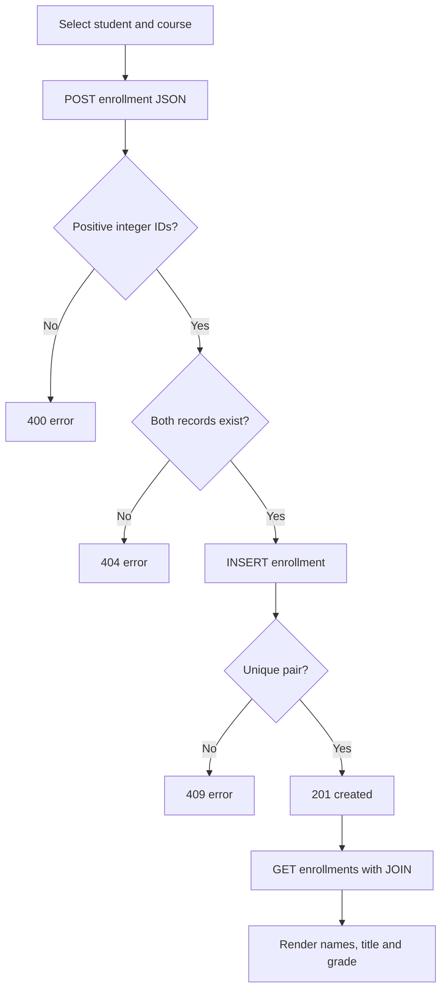

# 03 · Follow one request

## Responsibilities
The user operates the browser. Frontend HTML supplies structure, CSS controls layout and JavaScript validates forms, sends Fetch requests and renders data. Express validates untrusted input, applies rules and selects status codes. SQLite persists records and enforces keys and constraints. These boundaries separate concerns without introducing extra layers.

## REST and JSON
Resources have URLs: GET reads a collection, POST creates a record, PATCH changes a grade and DELETE removes a record. A successful create returns 201, a deletion returns 204 without a body, and validation errors return a JSON error envelope. JSON carries values, not executable code; numeric IDs and grades are sent as numbers.

## Enrollment flow

## Why the browser does not open SQLite
The browser is untrusted and cannot safely hold server filesystem access or enforce shared rules. A backend controls database access and validates every request. Hiding a button does not authorize an action. In production the backend also authenticates and authorizes callers.

## Debugging exercise
Open browser Network tools, submit a form and inspect method, URL, JSON body, status and response. Trace that request into a route, then its SQL statement. A Fetch promise does not reject just because HTTP returned 400: the request helper must check `response.ok`.
