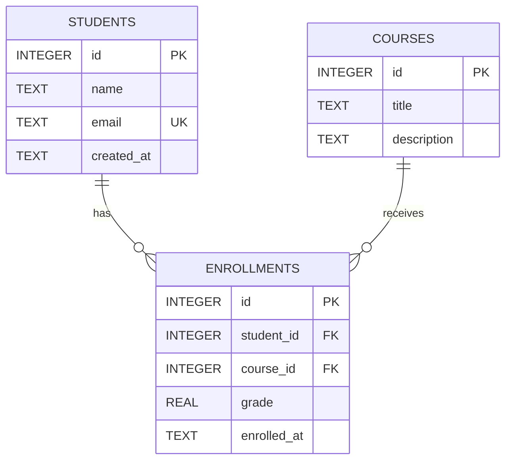

# 04 · From requirements to relational tables

## 1. Extract entities
Underline nouns in the interview: student, course and enrollment. Students have contact details; courses describe learning; an enrollment records a particular student's participation in a particular course.

## 2. Identify attributes and keys
| Entity | Attributes | Key decisions |
| --- | --- | --- |
| students | id, name, email, created_at | Integer primary key; case-insensitive unique email. |
| courses | id, title, description | Integer primary key; titles need not be unique. |
| enrollments | id, student_id, course_id, grade, enrolled_at | Integer primary key; two foreign keys; unique pair. |

An entity is a thing we store; an attribute describes it. A primary key identifies one row even when its name changes. A foreign key points to a row in another table.

## 3. Discover relationships
One student has many enrollments. One course has many enrollments. Therefore students and courses are many-to-many. We resolve this with the enrollments junction table: each enrollment connects exactly one student and one course.



## 4. Place facts at the correct level
Grade belongs to an enrollment: Sara may score 96 in Databases and 80 in Full Stack, while Ahmed has a different result in Full Stack. Putting grade on students would allow only one result per person; putting it on courses would give everyone the same result. NULL means “not graded”; zero is an actual result.

## 5. Protect integrity in SQL
Read [schema.sql](../schema.sql) while implementing:
- `INTEGER PRIMARY KEY` supplies an ID when omitted.
- `NOT NULL` rejects missing required values. CHECK also rejects blank names/titles.
- `email COLLATE NOCASE UNIQUE` prevents case variants of the same email; API trims and lowercases it.
- `UNIQUE(student_id, course_id)` prevents repeated enrollment, including competing inserts.
- `CHECK` limits grade to numeric 0–100 or NULL. SQLite type affinity alone is not strong validation.
- Foreign keys reject orphan enrollments. Every `openDatabase()` connection enables `PRAGMA foreign_keys = ON` before using tables.
- `ON DELETE CASCADE` removes enrollment rows when the referenced student or course is deleted. It does not delete courses when students are deleted.
- `DEFAULT CURRENT_TIMESTAMP` creates UTC timestamps; the browser converts them for display.
- The pair's unique index helps lookups by student; a separate course index helps course lookups/cascades.

## 6. Normalize before writing JOINs
Keep one value per field (first normal form); do not store comma-separated course IDs. Store student and course details once, rather than repeating them in each enrollment (avoids update anomalies and unnecessary dependencies). In the junction table grade depends on the student/course participation. This introduces practical second/third normal form ideas without a proof exercise.

```sql
SELECT s.name, c.title, e.grade
FROM enrollments e
JOIN students s ON s.id = e.student_id
JOIN courses c ON c.id = e.course_id;
```

## 7. Bind data, never build SQL from input
```js
const row = db.prepare('SELECT id FROM students WHERE email = ?').get(email);
```
The question mark is a bound value. Do not concatenate or interpolate form content into SQL. Static multiline SQL template literals in the routes contain no interpolated user input.

## 8. Evolve safely
`CREATE TABLE IF NOT EXISTS` initializes a new database; it does **not** update an existing table's definition. Production migrations version each schema change, preserve existing data and allow controlled rollout. For this workshop only, a disposable database can be removed and recreated after a schema edit; stop the server first and never do this with valued records.

## Exercise
Predict the result of inserting an unknown student ID, a duplicate pair and grade 101. Run the integration tests to confirm the database itself rejects invalid references and grades.
